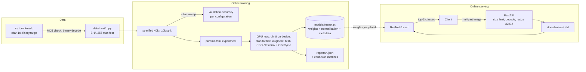

# CIFAR-10 ResNet Classifier


## Project Overview

A ResNet-9 that reaches **94.6 % test accuracy on CIFAR-10 in about one minute** of training on a
single GPU, wrapped in an engineering setup meant to be reused: a GPU-resident training loop,
declarative experiments with ablations, multi-seed evaluation, an image-upload FastAPI service,
and separate CPU (serving) and CUDA (training) Docker images.

**Key results**

- **0.9463 ± 0.0010** test accuracy over 3 seeds (single run 0.9458), with hyper-parameters chosen
  on a held-out validation split, never on the test set.
- **Ablations show where the accuracy comes from.** Removing data augmentation costs
  **6.1 pp**, by far the largest effect. Label smoothing adds 0.2 pp of accuracy but *worsens* log-loss
  (0.264 vs 0.187), a calibration trade-off worth knowing before using the probabilities.
  Fifteen epochs already reach 93.1 % in 20 s.
- **bf16 mixed precision trains 6.2× faster than fp32** on an RTX 5090 (68 s vs 421 s for
  50 epochs) at no accuracy cost (0.9458 vs 0.9417, single runs).
- **Same libraries, different platforms, slightly different models.** With identical PyTorch,
  CUDA and cuDNN versions, training inside a Linux container lands ≈ 0.2 pp below native
  Windows for each of three seeds (see [Reproducibility](#reproducibility)).

## Key Features

| Feature | Verified result |
|---|---|
| GPU-resident training loop | Whole dataset kept on the GPU as uint8 (150 MB); batched on-device random-crop and flip; bf16 autocast; channels-last; 50 epochs in **68 s** |
| Declarative experiments | Every run is a TOML table; ablations use `extends = "resnet"` and change one key each |
| Honest evaluation | `cifar sweep` searches on a stratified 40k / 10k validation split; the test set is used once; `--seeds N` reports mean ± std |
| Verified data pipeline | `cifar download-data` fetches the official binary release, checks the published MD5 and decodes fixed-size records (no pickle); SHA-256 manifest for the arrays |
| Image-upload REST API | `POST /predict` and `/predict/batch` (multipart PNG/JPEG, auto-resize, top-3); p50 **2.8 ms** over HTTP; 422 on non-images, 413 on oversized files/batches, 503 without a model |
| Safe model loading | `torch.load(weights_only=True)`; a test proves arbitrary pickled objects are refused |
| Tested and linted | **98 tests**, **99 % branch coverage**, Ruff clean; tests use synthetic data and run on CPU in ~35 s |
| Two right-sized images | CUDA image for training, CPU-only image for serving: **1.45 GB** vs **8.77 GB**; non-root, healthcheck, verified with `docker compose` |

## System Architecture



| Step | Training | Serving |
|---|---|---|
| Input | uint8 arrays from the official release | PNG/JPEG upload → RGB → 32×32 bicubic |
| Normalisation | per-channel mean/std of the **training images only** | the same statistics, stored in the model file |
| Augmentation | random crop (4 px reflect padding) + horizontal flip, on the GPU | none |
| Precision | bf16 autocast | fp32 |

## Tech Stack

| Layer | Tools |
|---|---|
| Deep learning | PyTorch 2.14 (CUDA 13.0), bf16 autocast, channels-last |
| Metrics | scikit-learn 1.9 (F1, log-loss, confusion matrix), Matplotlib |
| Configuration | pydantic-settings (`CIFAR_*` env vars / `.env`), TOML experiments with `extends` |
| Serving | FastAPI, Uvicorn, Pillow, python-multipart |
| Quality | pytest, pytest-cov, Ruff, type hints, Google-style docstrings |
| Deployment | Docker multi-stage build (CPU / CUDA variants), docker compose with GPU reservation |

## Quick Start

### Local

```bash
git clone https://github.com/daniel880830/cifar10-resnet-classifier.git
cd cifar10-resnet-classifier
python -m venv .venv && source .venv/bin/activate      # Windows: .venv\Scripts\activate
pip install torch==2.14.1 --index-url https://download.pytorch.org/whl/cu130   # or .../whl/cpu
pip install -r requirements-dev.txt && pip install -e . --no-deps
cp .env.example .env

cifar download-data                        # ~170 MB from the official site, MD5-checked
cifar verify-data                          # shapes + SHA-256 manifest

cifar train --experiment resnet            # the served model
cifar train --experiment resnet --seeds 3  # run-to-run variance
cifar sweep --experiment resnet --param lr=0.1,0.2,0.4 --param epochs=30,50   # validation split only
cifar train --experiment resnet_no_augment --experiment resnet_fp32 --no-save  # ablations
cifar serve                                # http://127.0.0.1:8000 redirects to /docs
```

```bash
cifar export-samples                       # one PNG per class from the test set -> samples/
curl -X POST http://127.0.0.1:8000/predict -F "file=@samples/cat_0.png"
# {"label":3,"class_name":"cat","probability":0.93,"top_k":[{"class_name":"cat",...},...]}
curl -X POST http://127.0.0.1:8000/predict/batch -F "files=@samples/cat_0.png" -F "files=@samples/ship_1.png"
```

### Docker

```bash
cifar download-data          # or place the four .npy files in data/raw/
docker compose up --build    # trains ResNet-9 on the GPU, then serves it from the CPU image
```

Requires the NVIDIA Container Toolkit (Docker Desktop + WSL 2 on Windows). Without a GPU, set
`CIFAR_TRAIN_DEVICE=cpu` and `CIFAR_TRAIN_EXPERIMENT=resnet_15_epochs`, or copy a trained
`models/resnet.pt` into the volume. The host port is `CIFAR_HOST_PORT` (default 8000).

## Evaluation & Benchmarks

Test set: the official 10,000 images (1,000 per class). Validation: a stratified 10,000-image
split of the training set (seed 42), used only for choosing hyper-parameters. Final models train
on all 50,000 training images. Every number below comes from a file in [`reports/`](reports).

### Hyper-parameter search (validation split)

[`reports/resnet_sweep_val.json`](reports/resnet_sweep_val.json)

| OneCycle peak LR \ epochs | 30 | 50 |
|---|---|---|
| 0.1 | 0.9272 | 0.9346 |
| 0.2 | 0.9331 | 0.9372 |
| 0.4 | 0.9365 | **0.9396** |

### Final model and ablations (test set)

Each ablation changes exactly one setting of the final configuration. Ablations are single runs;
the seed-to-seed spread of the full model is ±0.1 pp.

| Experiment | Change | Train time | Test accuracy | Macro-F1 | Log-loss |
|---|---|---|---|---|---|
| **ResNet-9** (served) | — | 68.4 s | **0.9458** (3 seeds: 0.9463 ± 0.0010) | 0.9458 | 0.264 |
| No augmentation | `augment = false` | 67.3 s | 0.8851 (−6.1 pp) | 0.8849 | 0.497 |
| No label smoothing | `label_smoothing = 0` | 64.5 s | 0.9436 (−0.2 pp) | 0.9436 | **0.187** |
| fp32 instead of bf16 | `amp = false` | 420.7 s (6.2× slower) | 0.9417 (−0.4 pp) | 0.9416 | 0.265 |
| 15 epochs | `epochs = 15` | **20.5 s** | 0.9306 (−1.5 pp) | 0.9305 | 0.300 |

Model: ResNet-9, 6.57 M parameters, SGD with Nesterov momentum 0.9, weight decay 5e-4, batch 512,
OneCycle peak 0.4, label smoothing 0.1.

The weakest classes are the visually similar pair **cat (F1 0.885)** and **dog (0.907)**: 65 cats are
predicted as dogs and 48 dogs as cats (out of 1,000 each). Confusion matrices are in
[`reports/figures/`](reports/figures).

### Inference performance (26.3 MB model file)

| Setting | Single image p50 / p95 | 1,000-image batch |
|---|---|---|
| CPU, in-process (8 threads) | 4.00 ms / 4.72 ms | 1.87 s (533 img/s) |
| GPU, in-process | 1.60 ms / 2.22 ms | 25.0 ms (39,956 img/s) |
| HTTP `POST /predict`, PNG upload, sequential, GPU server | 2.83 ms / 24.01 ms | 138 req/s |

Hardware: AMD Ryzen 7 7800X3D, 64 GB RAM, NVIDIA RTX 5090 (driver 610.88), Windows 11,
Python 3.13.5, PyTorch 2.14.1+cu130 ([`reports/benchmark.json`](reports/benchmark.json)).

### Docker images

| Image | Purpose | On disk | Compressed |
|---|---|---|---|
| `cifar10-resnet-classifier:cu130` | GPU training (`train` service) | 8.77 GB | 3.10 GB |
| **`cifar10-resnet-classifier:cpu`** | serving (`api` service) | **1.45 GB** | **321 MB** |

The serving image uses the CPU-only PyTorch wheel (the CUDA libraries are ~7 GB) and drops bundled
`tests/` folders, C/C++ headers, type stubs, bytecode caches and `pip`/`setuptools`; without those
steps the CPU image is 1.89 GB. Verified with `docker compose up`: GPU training in the container,
`api` healthy, correct prediction for a sample image, 422 for a non-image upload, process running
as the non-root `app` user.

### Reproducibility

- CPU training is bit-reproducible (tested). GPU training is not: cuDNN picks non-deterministic
  kernels, which is why final numbers are reported over seeds.
- Training inside the Linux container gives slightly lower accuracy than native Windows, with
  **identical PyTorch 2.14.1, CUDA 13.0, cuDNN 9.24 and NumPy 2.5.4**
  ([`reports/resnet_seeds_linux_docker.json`](reports/resnet_seeds_linux_docker.json)):

  | Seed | Windows (native) | Linux (Docker, WSL 2 GPU) |
  |---|---|---|
  | 0 | 0.9458 | 0.9424 |
  | 1 | 0.9457 | 0.9444 |
  | 2 | 0.9474 | 0.9461 |
  | mean ± std | 0.9463 ± 0.0010 | 0.9443 ± 0.0019 |

  Each platform repeats a seed almost exactly, but Linux is lower for all three seeds
  (≈ 0.2 pp on average; the ranges overlap). The most likely cause is cuDNN choosing different
  convolution kernels on the native driver vs. the WSL 2 path; I have not verified this.

## Project Background

An independent portfolio project. After working with small CNNs on image classification in a
team setting, I wanted to see how far a careful training recipe gets on a single consumer GPU,
which of its ingredients actually matter (the ablations), and what it takes to serve the
result reliably: a tested API, safe model loading, and containers sized for their job.

## Data and License

Code: [MIT](LICENSE). CIFAR-10 (Krizhevsky, 2009) is downloaded from the official site and
not stored in this repository; see [`data/README.md`](data/README.md).

## Project Structure

```
cifar10-resnet-classifier/
├── config/params.toml           # the ResNet-9 experiment and its ablations
├── data/
│   ├── README.md                # source, checksum, citation
│   ├── manifest.json            # SHA-256 of the four .npy files
│   └── raw/                     # written by `cifar download-data` (git-ignored)
├── models/                      # resnet.pt (git-ignored)
├── reports/                     # metrics, seeds, sweep, benchmark, figures/
├── src/cifar_classifier/
│   ├── config.py   data.py     models.py    engine.py    train.py
│   ├── evaluate.py predict.py  schema.py    benchmark.py
│   └── api.py      cli.py
├── tests/
│   ├── unit/                    # config, data (download/decode), engine, model, training, prediction
│   └── integration/             # API (TestClient), CLI, real-data checks
├── .run/                        # shared PyCharm run configurations
├── Dockerfile   docker-compose.yml   .env.example
└── pyproject.toml   requirements.txt   requirements-dev.txt
```
